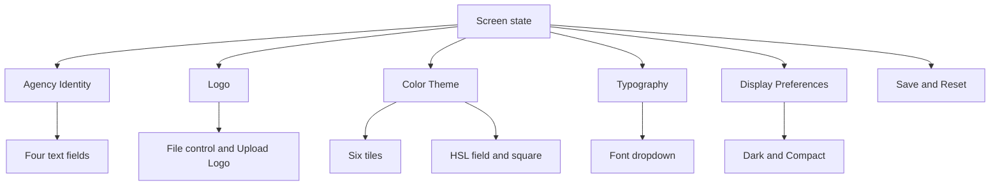
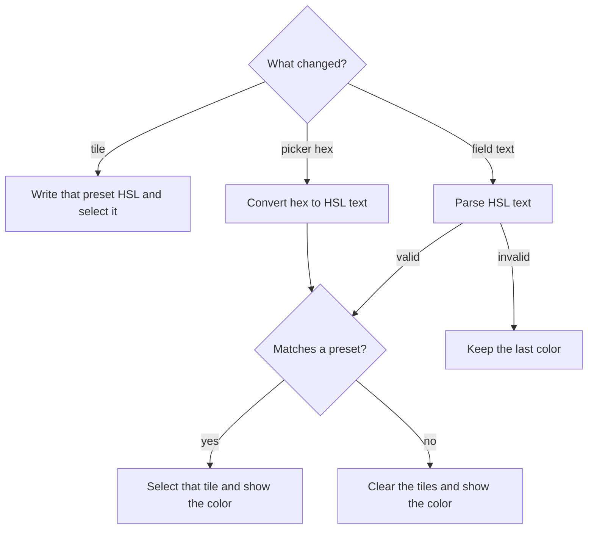

# Agency Branding Settings - Plan

## Goal Capsule

- **Objective:** A person can try an agency branding template, set its fields, and return them to the start, without those choices being stored or changing the template's own chrome.
- **Means:** One in-memory form written in `src/App.tsx`, built from shared controls (KTD1, KTD3).
- **Authority:** Product requirements win on behavior. Planning decisions win on mechanism. Units follow both.
- **Execution profile:** Code change, checked with the repo's lint and build and with a browser pass. Do not add a test runner.
- **Stop conditions:** Stop if the work needs a server, storage that survives refresh, or restyling the page from the font, the custom color, or the display switches.
- **Finishes the work:** An implementer in this repo.

---

## Product Contract

### Summary

`src/App.tsx` shows a client-only Agency branding template. Identity, logo, six named colors, type, and two display switches all work in the browser. A refresh returns the start, and those choices do not restyle the template.

### Problem Frame

This is a standard template for testing the branding controls. It is not a product, and nothing else in the repo has to keep working beside it. `src/App.tsx` is only the file that renders the template, so replacing the starter markup there is the mount, not a migration. The controls still have to work in the browser, with no backend.

### Key Decisions

- **Named color presets** (session-settled: user-directed — chosen over an unnamed palette picked in the plan: the user named Navy, Teal, Forest, Slate, Plum, and Crimson, and marked Navy as the default.) Governs R11, R13.
- **Save lasts until refresh, and Reset returns the start** (session-settled: user-approved — chosen over remembering the last save across reloads: the user confirmed values live only in the open page.) Governs R22.
- **Display choices stay on their controls** (session-settled: user-approved — chosen over restyling the page: the user confirmed font, custom color, dark mode, and compact mode update only their own controls.) Governs R3, R14, R16, R18.

### Requirements

**Document**

- R1. The template is what `src/App.tsx` renders. The starter markup in that file is replaced because that is the template's mount.
- R2. The document body uses a small padding of `p-4`.
- R3. The page stays light when the operating system is set to dark.

**Identity**

- R4. Agency Identity spans the full width, shows the bold name Agency Identity, and shows the description "How your agency appears across the platform, in reports, and in communications".
- R5. That section has two rows of two fields. The first row is Legal Name and Display Name. The second is Sidebar Brand Name and Powered By Text. Each label sits above its field.
- R6. Each identity field starts empty, and typed text appears in that field immediately.

**Logo**

- R7. Logo spans half the width, shows the bold name Logo, and shows the description "Upload your agency logo. Used in the sidebar, PDF reports, and email templates".
- R8. The section shows a file control and, beside it, a button labeled Upload Logo with an upload icon to the left of the label.
- R9. The logo starts empty. Choosing an image shows that image on the control. Dismissing the dialog, or choosing a file that is not an image, leaves the current logo in place.

**Color**

- R10. Color Theme spans the full width, shows a color-palette icon, the bold name Color Theme, and the description "Choose a preset or define a custom primary color. Affects buttons, links, badges, and accents across the platform".
- R11. Six rounded tiles show Navy, Teal, Forest, Slate, Plum, and Crimson, each as a filled circle with the name underneath. Navy starts selected. The selected tile's background dims and its border is `hsl(215 65% 30%)`.
- R12. Custom Primary (HSL) places its label to the left of the field. The field and the preview square together span about a quarter of the width. The square shows the current color.
- R13. The field shows the current color as `H S% L%`, and at the start that text is Navy's HSL. Opening the square lets the user pick a color or type a hex code, and the field then shows the HSL of that color.
- R14. Changing the preset or the custom color does not change the page's buttons, links, or background.

**Type and display**

- R15. Typography shows a text icon, the bold name Typography, and the description "Font family used across the platform UI", plus a dropdown.
- R16. The dropdown options are Inter (Default), Arial, Roboto, Open Sans, Lato, and Source Sans Pro. Inter starts selected. Changing it does not change the page's type.
- R17. Display Preferences shows an eye icon and the bold name Display Preferences, and it has no description.
- R18. Dark Mode and Compact Mode are stacked, rounded rows with horizontal padding of 2 and vertical padding of 4, and each has a switch on the right. Both start off. Flipping a switch changes only that switch.

**Actions and shared controls**

- R19. The action section spans about a quarter of the width and contains two buttons.
- R20. Save branding changes uses background `hsl(215 65% 30%)` and white text.
- R21. Reset to Defaults uses a white background and text `hsl(215 65% 30%)`.
- R22. Save keeps the current values only until a refresh, and it does not send them anywhere. Reset returns every control to the start, including after Save in the same visit.
- R23. Container is a section. Its name is required and bold. Its description and icon are optional.
- R24. Button shows its icon to the left of its text.
- R25. InputField can place its label above the field or to the left of it.

### Acceptance Examples

- AE1. Covers R11, R13, R14. Given Navy selected, when the user selects Teal, Teal is the only selected tile, the field shows Teal's HSL, the square matches that color, and the Save button stays `hsl(215 65% 30%)`.
- AE2. Covers R13, R11. Given any current color, when the user enters `#0000ff` in the picker, the field shows `240 100% 50%` and no tile is selected.
- AE3. Covers R22. Given Legal Name set to `North` and Save clicked, when the user refreshes, Legal Name is empty and Navy is selected.
- AE4. Covers R22. Given the same edits and Save clicked, when the user clicks Reset, Legal Name is empty and Navy is selected without a refresh.
- AE5. Covers R9. Given a chosen PNG, when the user then chooses a text file, the PNG stays and the control says the file is not an image. Dismissing the dialog leaves that PNG in place.
- AE6. Covers R3, R18. Given a dark operating system and Dark Mode off, the page background stays light. Flipping Dark Mode moves that switch and the background stays light.

### Scope Boundaries

- This is a test template, not a product. Writing it into `src/App.tsx` replaces the starter markup, and that replacement does not need a preservation path.
- The page is the form. Legal Name, Display Name, Sidebar Brand Name, Powered By Text, and the logo do not appear in a sidebar, a report, or an email.
- The six preset names are fixed. Their HSL values are the ones in KTD5.
- Save does not create a second copy of the form for some other view to read.

#### Deferred to Follow-Up Work

- A written learning under `docs/solutions/` after this page exists. Nothing there records this pattern today.

#### Outside this product's identity

- A backend, accounts, or more than one agency.
- Storage that survives refresh, including `localStorage`.
- Loading webfonts, adding an icon package, or painting the page in the chosen font or primary color.
- A test runner. This repo does not have one, and this page does not add one.

### Sources

- `src/index.css` sets `color-scheme: light dark`, repaints `:root` inside `prefers-color-scheme: dark`, and fixes `#root` at 1126px. `src/main.tsx` loads that file for every view.
- `src/App.css` styles only the starter screen. `src/App.tsx` is the only UI, and its state is one `useState` call.
- `tsconfig.app.json` compiles `src` only, allows `.tsx` imports, and rejects enums. `package.json` has lint and build, and it has no test script, icon package, or color package.
- `.cursor/skills/react-component-conventions/SKILL.md` is the component layout to follow when the repo has no component tree yet.
- `public/icons.svg` only contains the starter symbols, so it cannot supply the palette, text, eye, or upload icons.

---

## Planning Contract

### Key Technical Decisions

- KTD1. **Put each control in its own folder under `src/components/ui`.** The repo has no component tree, and TypeScript only compiles `src`. Each control gets `src/components/ui/<Name>/index.tsx`, with a const component, a props interface in that file, and a default export. `src/App.tsx` stays the screen that assembles them. Building all seven controls inside `src/App.tsx` was the alternative, and it would hide the controls the request asked to create.
- KTD2. **Replace the starter document styles.** Keep the Tailwind import in `src/index.css`. Remove the dark-scheme block, the `#root` frame, and the starter heading sizes. Set the document to a light scheme. Put `p-4` on the body in `index.html`. Stop loading `src/App.css` and delete that file. Those rules are what would keep painting the page after the starter markup is gone.
- KTD3. **Keep one settings object in the screen.** The screen owns the object and passes values down. Controls report changes. They do not keep a second copy. Reset replaces the object with the start values from R6, R9, R11, R13, R16, and R18. Save does not copy the object. It sets a status of Saved on the action row, and the next edit or Reset clears that status. Both buttons are button-type controls so Enter in a field does not reload the page.
- KTD4. **Leave the document theme alone.** Do not write the chosen font, the primary color, or a dark or compact scheme onto `:root` or the body. The Save and Reset colors in R20 and R21 stay the fixed `hsl(215 65% 30%)` pair, including after a new primary is chosen. (session-settled: user-approved — chosen over restyling the page: the user confirmed font, custom color, dark mode, and compact mode update only their own controls.) Implements R3, R14, R16, R18.
- KTD5. **Use one primary color, stored as HSL text.** Selecting a tile writes that tile's HSL into the field and selects the tile. A parsed value that equals a preset selects that tile. Any other parsed value clears the selection. Invalid text leaves the square and the picker on the last parsed color. The picker is the native color input, opened from the square, and its hex is converted into `H S% L%` rounded to whole numbers. The preset HSL values are Navy `215 65% 30%`, Teal `174 62% 32%`, Forest `152 40% 28%`, Slate `215 16% 47%`, Plum `300 24% 40%`, and Crimson `350 65% 42%`. A separate preset plus an unrelated hex was the other shape. The section copy already says to choose a preset or define a custom primary, so this is that wording rather than a split worth building twice.
- KTD6. **Preview a logo from the chosen file.** Treat `image/png`, `image/jpeg`, `image/webp`, `image/gif`, and `image/svg+xml` up to 2MB as images for R9. Show the image and its file name. A rejected file shows a short message and keeps the previous logo. Preview through an image element and an object URL, and revoke that URL when the file is replaced, cleared, or the screen unmounts. Do not add a separate remove control. Reset is the way back to no logo.
- KTD7. **Draw the four icons as inline SVG.** Do not add an icon package, and do not reuse the starter symbols in `public/icons.svg`. Do not load font files for the dropdown labels. The labels are Inter (Default), Arial, Roboto, Open Sans, Lato, and Source Sans Pro, drawn in the page's existing type.

### High-Level Technical Design

The screen owns the settings object. Each section reads from it and reports changes. Save and Reset are the only actions. Save does not copy the settings object. It sets a Saved status on the action row. Reset replaces the object with the start values. Neither sends the settings object outside the screen.



Color has one value. A tile, the field, and the picker all write that value, and the tiles only show a selection when the value matches a preset.



### Output Structure

```text
index.html
src/index.css
src/App.tsx
src/components/ui/Container/index.tsx
src/components/ui/Button/index.tsx
src/components/ui/InputField/index.tsx
src/components/ui/FileUpload/index.tsx
src/components/ui/ColorSelector/index.tsx
src/components/ui/FontSelector/index.tsx
src/components/ui/ThemePreference/index.tsx
```

`src/App.css` is removed. A color conversion helper may sit beside `ColorSelector` and must not be exported from that component file.

### Sequencing

U1 and U2 can land in either order. U3 needs U2 because the HSL field uses InputField. The Upload Logo button is placed in U4 and is not part of FileUpload. U4 needs U1, U2, and U3.

### Risks

- The native color picker always stores hex, and browsers differ in how clearly they let someone type it. The field still updates from that hex on change, per KTD5.
- Rounding HSL to whole numbers can shift a hex by one step on the way back to the picker. Keep HSL as the stored value and derive the picker hex from it, so the field does not drift while the picker is closed.
- An SVG logo is previewed as an image, not inserted as markup.

### Deferred implementation notes

- The exact path commands inside each inline icon.
- The exact helper name for the hex and HSL conversion, as long as it stays unexported from the component module and follows KTD5.

---

## Implementation Units

### U1. Replace the starter document shell

- **Goal:** The document no longer uses the Vite frame or the operating-system dark theme.
- **Requirements:** R2, R3
- **Dependencies:** none
- **Files:** `index.html`, `src/index.css`, `src/App.css`, `src/App.tsx`
- **Approach:** Apply KTD2. Leave the Tailwind import in place. Remove the `App.css` import from `src/App.tsx` in this unit even if the starter markup is still there until U4.
- **Execution note:** This is document styling. Confirm it in the browser with the operating system set to dark, instead of adding a test runner.
- **Patterns to follow:** `src/main.tsx` already loads `src/index.css`. Keep that import.
- **Test scenarios:**
  - Happy path: the body has `p-4`, and on a light operating system the page background stays light.
  - Edge case: with the operating system set to dark, the page background stays light and the text stays dark.
  - Integration: a later `w-1/2` section is half of the padded page, not half of a 1126px centered frame.
- **Verification:** The dark-scheme block and the `#root` width rule are gone from `src/index.css`, `src/App.css` is gone, and the browser shows a light page under a dark operating system.

### U2. Add Container, Button, and InputField

- **Goal:** The three shared controls exist and match the layout props the page needs.
- **Requirements:** R23, R24, R25
- **Dependencies:** none
- **Files:** `src/components/ui/Container/index.tsx`, `src/components/ui/Button/index.tsx`, `src/components/ui/InputField/index.tsx`
- **Approach:** Follow KTD1. Container accepts a name, an optional description, an optional icon, and an optional class name so the page can set width. Button accepts an icon and a label. InputField accepts a label, a placement of above or beside, a value, and a change callback. Export only the component from each file.
- **Patterns to follow:** `src/main.tsx` imports `./App.tsx` with the extension. New files use the same style of import. Do not use an enum.
- **Test scenarios:**
  - Happy path: Container with a name, a description, and an icon renders a section whose name is bold.
  - Edge case: Container with only a name renders the bold name and no empty description or icon slot.
  - Happy path: InputField with placement above puts the label over the field, and placement beside puts the label to the left.
  - Happy path: Button with an icon renders that icon to the left of the text.
  - Integration: the controls accept a value and report a change, so U4 can own the state.
- **Verification:** The three folders exist, each file default-exports one component, and a temporary render of each prop combination matches the scenarios above.

### U3. Add file, color, font, and theme controls

- **Goal:** The four specialized controls can be driven by the screen's settings object.
- **Requirements:** R8, R9, R11, R12, R13, R16, R18
- **Dependencies:** U2
- **Files:** `src/components/ui/FileUpload/index.tsx`, `src/components/ui/ColorSelector/index.tsx`, `src/components/ui/FontSelector/index.tsx`, `src/components/ui/ThemePreference/index.tsx`
- **Approach:** Follow KTD5, KTD6, and KTD7. ColorSelector renders the six tiles plus the custom field and square, using InputField for the HSL label on the left. FileUpload shows the current image and file name, and the Upload Logo button lives beside it in U4 rather than inside this control. FontSelector is a dropdown with the six names. ThemePreference is the two stacked rows and switches. None of these components write to the document theme (KTD4).
- **Patterns to follow:** U2's component shape. Keep the conversion helper unexported from the component file.
- **Test scenarios:**
  - Happy path: selecting Forest sets the field to `152 40% 28%`, fills the square with that color, and dims only the Forest tile with border `hsl(215 65% 30%)`.
  - Happy path: entering `#0000ff` in the picker sets the field to `240 100% 50%` and leaves every tile unselected.
  - Edge case: typing `nope` into the HSL field leaves the square on the last valid color.
  - Error path: choosing a text file after a PNG keeps the PNG and shows that the file is not an image. Dismissing the dialog keeps the PNG.
  - Edge case: a second image replaces the first, and the previous object URL is revoked.
  - Happy path: the font dropdown lists Inter (Default), Arial, Roboto, Open Sans, Lato, and Source Sans Pro, and choosing Arial does not change the page font.
  - Happy path: Dark Mode and Compact Mode flip independently, and neither changes the page background or spacing outside its own row.
- **Verification:** Each control renders from passed-in values, reports changes, and leaves the document colors and font untouched.

### U4. Assemble the branding page

- **Goal:** `src/App.tsx` renders the branding template and wires Save and Reset.
- **Requirements:** R1, R4, R5, R6, R7, R8, R10, R15, R17, R19, R20, R21, R22
- **Dependencies:** U1, U2, U3
- **Files:** `src/App.tsx`
- **Approach:** Write the template in `src/App.tsx` in place of the starter markup. Hold the settings object from KTD3. Pass Container widths only for Agency Identity (full), Color Theme (full), and Logo (half). Inside ColorSelector, the custom field and preview square together span about a quarter of the width, with the label to their left. Make the action section a plain wrapper about a quarter of the width, with the two buttons and no section heading. Make Upload Logo a button whose click opens the Logo file dialog. Save sets the Saved status from KTD3. Reset restores the start. Do not apply KTD4's excluded document styles.
- **Execution note:** Prove this screen in the browser. The repo has no test runner, and this unit does not add one.
- **Patterns to follow:** The current `src/App.tsx` is a function component with local state and a default export. Keep that shape for the screen.
- **Test scenarios:**
  - Happy path: the page shows Agency Identity, Logo, Color Theme, Typography, Display Preferences, and the two action buttons, with the widths from R4, R7, R10, R12, and R19.
  - Happy path: AE1, AE2, and AE4 behave as written.
  - Edge case: AE3. After Save, a refresh shows empty identity fields, no logo, Navy, Inter, and both switches off.
  - Error path: AE5. A text file does not clear a PNG, and Reset then clears the PNG.
  - Integration: AE6. A dark operating system does not darken the page, and flipping Dark Mode still only moves its switch.
  - Integration: choosing a font or a non-navy primary leaves the Save button on `hsl(215 65% 30%)` with white text.
- **Verification:** The starter hero, counter, and link lists are gone. The browser pass above succeeds. Lint and build succeed.

---

## Verification Contract

| Check | How | Units |
| --- | --- | --- |
| Lint | `npm run lint` | U1–U4 |
| Types and production build | `npm run build` | U1–U4 |
| Browser pass | Run the dev server and walk the U4 scenarios, including a dark operating system for AE6 | U1, U4 |

There is no test script in `package.json`. Do not treat a missing unit-test file as a failure for this plan.

---

## Definition of Done

- R1 through R25 hold, including AE1 through AE6.
- `src/App.tsx` renders the template, and the starter markup is gone from that file.
- `src/App.css` and the operating-system dark theme in `src/index.css` are gone so the template layout is visible.
- `npm run lint` and `npm run build` succeed.
- The browser pass in the Verification Contract succeeds.
- Experimental code from abandoned approaches is not left in the change.
